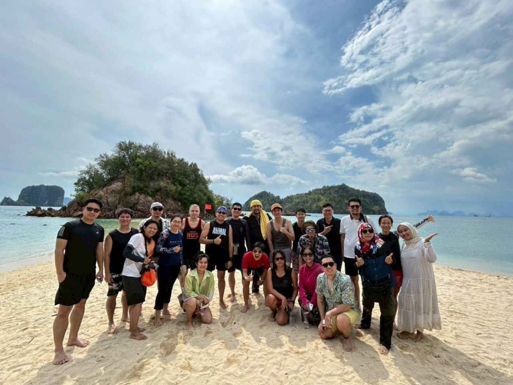

---
# ── Copy this file into the events/ folder and rename it, e.g. events/2026-01-my-event.qmd ──
title: "Modelling Infectious Disease in Southeast Asia - Forum for Inclusive Exchange of Sustained Transformative Actions (MIDSEA-FIESTA)"
date: 2026-05-04
# For date ranges, use the start date above and describe the range in
# event-dates below so it displays nicely, e.g. "22 - 29 June 2026".
event-dates: "4 - 8 May 2026"
location: "Krabi, Thailand"
image: ../images/events/20260504-fiesta.jpg
description: "A week-packed forum to reflect on the last three years of the network and lay out roadmaps for the years to come."
categories: [Workshop]
# Pick one or more tags from: Online Events, Seminars, Summer School.
# Also add "Upcoming" or "Past" so the filter chips on the Events page work,
# e.g. categories: [Seminars, Upcoming]
---

# Workshop Summary

## Orientation, Vision, and Subgroup Formation
*Day: Monday 4 May, morning · Lead: Wirichada Pan-ngum*

The opening session moved from introductions through to the formation of working subgroups for the week. Participants began by sharing their research interests, network experiences, wish lists for MIDSEA, and the skills and time they could contribute. This was followed by an orientation to the week's working principles: flexibility, concrete deliverables across short and long time horizons, sustainable participation styles, and meaningful engagement of early-career (ECR) and mid-career researchers (MCR).

A group discussion and SWOT analysis then explored why networks matter, what makes regional networks in Asia distinct, and how theory-of-change thinking could guide MIDSEA's growth. The session then turned to co-creating MIDSEA's long-term vision and core values, drawing on the SEADREAM draft proposal, with discussion of branding, network alliances, and participants' aspirations for MIDSEA in 5 and 10 years.

The session concluded with the formation of six working subgroups:

| Subgroup | Lead |
|----------|------|
| Constitution, membership, and involvement paths | Aurelio de los Reyes V |
| Webinars, web, communications, and document sharing | Thinh Ong Phuc |
| National and regional capability building | Iqbal Elyazar |
| Policy impact strategies | Alex R Cook |
| Research collaboration strategies | Keisuke Ejima |
| Career development | Lam Phung |

## Subgroup Discussions
*Day: Monday 4 May, afternoon · Coordination: Bimandra Adiputra Djaafara*

Subgroups held initial discussions and began drafting their plans. End-of-day verbal reports were collected. The research collaboration subgroup polled members on thematic research interests to inform Wednesday's research themes workshop. The welcome dinner provided informal networking time.

## **Lecture 1:** R~0~ Derivation in Heterogeneous Populations
*Day: Tuesday 5 May, morning · Speaker: Jomar F. Rabajante*

A technical lecture on the mathematical derivation of the basic reproduction number R~0~ in heterogeneous population models, covering the next-generation matrix approach and its implications for disease control thresholds in structured populations.

## Subgroup Written Plans
*Day: Tuesday 5 May, morning · Coordination: Bimandra Adiputra Djaafara*

Each subgroup produced a structured written plan covering objectives, planned activities, milestones, evaluation criteria, and resource needs. Plans were shared across subgroups for peer comment in the afternoon.

## Cross-Subgroup Peer Review and Resourcing Brainstorm
*Day: Tuesday 5 May, afternoon*

Subgroups reviewed and commented on one another's draft plans asynchronously via shared documents. Subgroups then revise plans in light of feedback and identify minimum resource requirements for each activity. A collective brainstorm generated ideas for resourcing strategies, including grant applications, host-institution underwriting, and voluntary effort.

## **Lecture 2:** Environmental Datasets for Infectious Disease Modelling
*Day: Wednesday 6 May, morning · Speaker: Nguyen Duy Tung*

A technical lecture on environmental datasets available in Southeast Asia - including land use, climate, and ecological data - and their role in parameterising and validating infectious disease models. The session introduced data sources and methodological approaches for integrating environmental drivers into models.

## Research Themes Workshop
*Day: Wednesday 6 May, morning · Lead: Keisuke Ejima*

Participants identified and mapped priority research themes for MIDSEA collaborative work. Breakout discussions covered the current status of work in each area, key open questions, and which MIDSEA members were active in each theme. A shortlist was agreed for further development on Thursday.

## Excursion - Hong Island
*Day: Wednesday 6 May, afternoon · Coordinator: Phrutsamon Wongnak*

Half-day excursion to Hong Island, providing informal networking time between participants.

## **Lecture 3:** Novel Methods for Contact Patterns
*Day: Thursday 7 May, morning · Speaker: Kiesha Prem*

A technical lecture on approaches to measuring and modelling social contact patterns, covering novel data collection methods, their use in age-structured transmission models, and implications for intervention design.

## Research Enablers - Funding, Students, and Mobility
*Day: Thursday 7 May, morning · Lead: Norvin P. Bansilan*

The session mapped existing mechanisms to enable research across MIDSEA: grant funding sources, student recruitment pathways, mobility schemes for students and faculty, and institutional agreements. Participants identified key barriers - fragmented funding landscapes, visa constraints, limited mobility schemes - and opportunities across the regional ecosystem.

## Research Theme Written Roadmaps
*Day: Thursday 7 May, afternoon*

Research theme groups produced structured written roadmaps covering objectives, activities, milestones, evaluation indicators, responsibilities, meeting cadence, communication methods, and resources needed. Preliminary concept notes for grants, collaborative research, or papers were drafted where time permitted.

## **Lecture 4:** Grant Development
*Day: Friday 8 May, morning · Lecturers: Wirichada Pan-ngum and Hannah Clapham*

Introduction to key grant writing principles - conceptual framework, theory of change, measurable milestones, and alignment with funder priorities - followed by direct feedback on each research theme's concept note, identifying strengths, gaps, and positioning opportunities. Research theme groups presented concept notes to the full group receiving comments in light of the grant writing discussions. The session closed with a synthesis of all FIESTA outputs - subgroup plans, research roadmaps, and enabling strategies - and confirmed next steps and responsibilities for the MIDSEA network going forward.

## Within-Country Teaching
*Day: Friday 8 May, afternoon · Lead: Thitiya Theparod*

Country teams present status quo, case studies, and prospective plans for cross-learning. The countries included the Philippines, Indonesia, Vietnam, Laos PDR, and Thailand.

