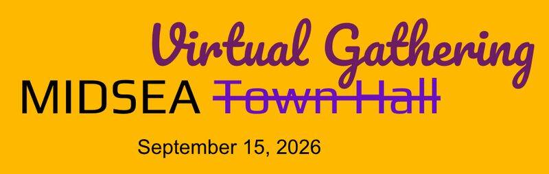

---
# ── Copy this file into the events/ folder and rename it, e.g. events/2026-01-my-event.qmd ──
title: "MIDSEA Virtual Gathering"
date: 2026-09-15
# For date ranges, use the start date above and describe the range in
# event-dates below so it displays nicely, e.g. "22 - 29 June 2026".
event-dates: "15 September 2026"
location: "Online"
image: ../images/events/20260915-midsea-virtual-gathering.jpg
description: "A virtual gathering in the MIDSEA way to report back from our MIDSEA-FIESTA and chart the strides forward."
categories: [Online Events]
# Pick one or more tags from: Online Events, Seminars, Summer School.
# Also add "Upcoming" or "Past" so the filter chips on the Events page work,
# e.g. categories: [Seminars, Upcoming]
---

A virtual gathering in the MIDSEA way to report back from our MIDSEA-FIESTA and chart the strides forward.

**Key actions:**
After 3 years of organic growth, Modelling Infectious Diseases in South East Asia (MIDSEA) now leaping forward to have a defined body of members! We now have an (almost) working communication means via Zulip, undergoing vibrant interactions to form our fun [chaotic] #democratic #governance and task forces. Let's shape and enjoy this community together!
