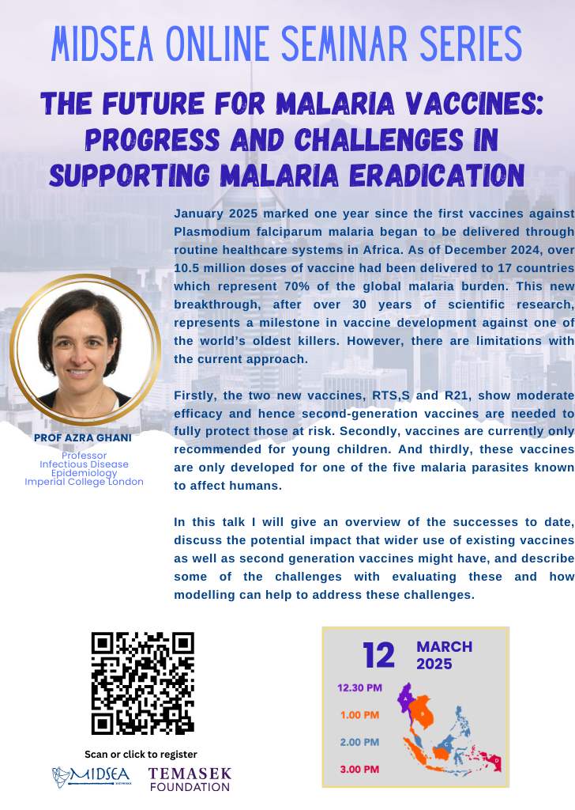

---
# ── Copy this file into the events/ folder and rename it, e.g. events/2026-01-my-event.qmd ──
title: "The Future for Malaria Vaccines: Progress and Challenges in Supporting Malaria Eradication"
date: 2025-03-12
# For date ranges, use the start date above and describe the range in
# event-dates below so it displays nicely, e.g. "22 - 29 June 2026".
event-dates: "12 March 2025"
location: "Online"
image: ../images/events/webinar-research/20250312-trimmed.png
description: "Research Webinar series"
categories: [Online Events, Seminars, Past]
# Pick one or more tags from: Online Events, Seminars, Summer School.
# Also add "Upcoming" or "Past" so the filter chips on the Events page work,
# e.g. categories: [Seminars, Upcoming]
---

