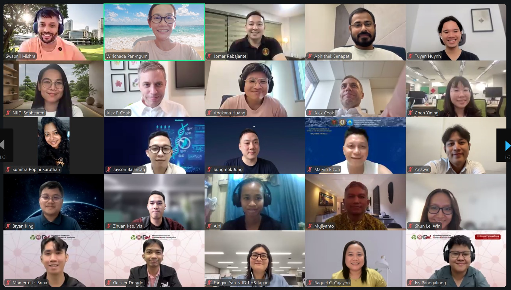
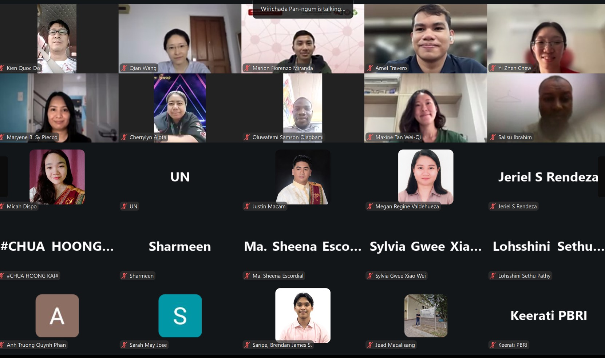

## A New Space for Southeast Asian Dialogue

The MIDSEA Climate and Health Modelling Seminar Series kicked off this week, marking the start of an expanded seminar format dedicated to special-topic dialogues on issues that pertain specifically to Southeast Asia. The series aims to be a space not only to drive technical and scientific progress, but also to define the important questions that might otherwise be missed in the global climate-health dialogue — questions that are often shaped by data, settings, and priorities from outside the region.

The kickoff session brought together four presentations spanning methodological innovation, regional epidemiology, extreme weather impacts, and open critical reflection on the state of the field.

## Jomar: Free-Form ODEs for Infectious Disease Modelling

Jomar opened the session with a talk on free-form ODEs for infectious disease (ID) modelling, introducing a [Shiny app](https://jfrabajanteuplb.shinyapps.io/EPIDSS/) as a companion tool for exploring the approach. Central to the talk was the use of Bezier curves — a technique widely used in design for producing a smooth curve from a small number of geometric handles. Jomar explained that Bernstein polynomials allow the "pull" of each handle on the curve to be made exact, giving a level of control that is notably different from, and more precise than, typical spline-based approaches.

The core methodological idea was what Jomar termed the "free-form ODE": rather than the conventional ID modelling workflow of starting from a mechanistic model and solving forward, this approach starts by constructing the curve and then solves for the underlying ODE — effectively reversing the usual direction of the modelling process. This framework was proposed as a way to represent climate inputs and other time-varying drivers more flexibly within transmission models.

The talk raised several open questions for the group: when constructing these curves, how should one choose *where* to place control points, beyond simply identifying the minimum number needed, and when is it worth using more than the minimum? How do these Bezier-based representations compare to more familiar decomposition methods such as Fourier decomposition or sliding window averages? And on the modelling side, a clarifying question was raised about whether the driving reproduction number term, $R_{drv}(t)$, is equivalent to the conventional $R_0(t)$.

## Sophearen: Climate and Vector-Borne Diseases in Asia

Sophearen's talk examined the relationship between climate and vector-borne diseases across Asia, with a focus on dengue in Southeast Asia and febrile/syndromic surveillance systems in Japan.

A key discussion point centered on why temperature-dependent relative risk (RR) curves differ across locations, with immunity raised as a plausible mediating factor behind this heterogeneity. This prompted a broader critical question for the field: given this location-specific variation, what should we make of the many extrapolation models that rely on global RR curves rather than context-specific ones? A related methodological question concerned whether RR estimates should be based on reported case counts or on reconstructed infection numbers, each of which can carry different biases and assumptions.

## Abhisek: Extreme Weather Events and Infectious Disease

Abhisek's presentation turned to the impact of extreme weather events (EWEs) on infectious disease dynamics, raising a provocative framing question for modellers in the room: when an extreme weather event occurs, is vector competence still the dominant factor driving transmission risk, or do other forces — infrastructure collapse, displacement of populations, and loss of livelihoods — become the more important drivers? This question pushed the discussion beyond purely biological or entomological mechanisms toward the broader social and systemic disruptions that accompany climate extremes.

## Tuyen: Discussion and Open Reflections

Tuyen's segment shifted from presenting new findings to opening up broader discussion points for the group. One major theme was geographic relevance: given that much of the global research focus on dengue originates from (re-)emerging settings such as Latin America, the United States, and Europe, how much of those findings genuinely translate to the Southeast Asian context?

A second theme concerned model complexity and epistemic humility. Climate affects transmission systems through a multitude of pathways, many of which are not incorporated into most existing transmission models. This raised a question that resonated across the session as a whole: how far do modellers need to go in accounting for this complexity, and how can the field be confident in the robustness of its findings and conclusions given everything that remains left out?

## Looking Ahead

Across all four talks, a common thread emerged — the tension between the sophistication of modelling tools and the uncertainty of what they capture, especially when applied to a region whose epidemiological, social, and climatic realities differ from where much of the foundational research originates. As the MIDSEA series continues, these open questions on model design, regional applicability, and the limits of current transmission frameworks are likely to shape the dialogue in sessions to come.