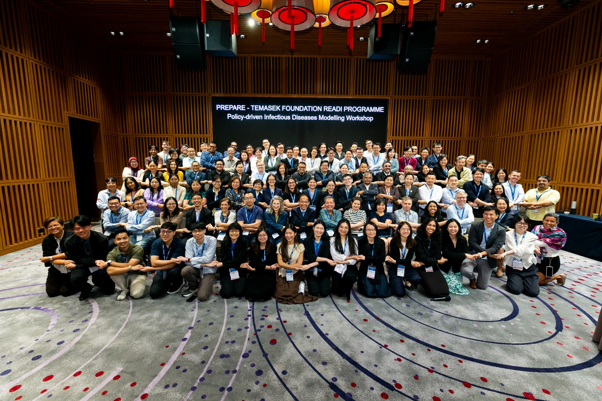

---
# ── Copy this file into the events/ folder and rename it, e.g. events/2026-01-my-event.qmd ──
title: "PREPARE-TF READI Workshop (Policy-driven Infectious Diseases Modelling)"
date: 2026-05-11
# For date ranges, use the start date above and describe the range in
# event-dates below so it displays nicely, e.g. "22 - 29 June 2026".
event-dates: "11 - 15 May 2026"
location: "Singapore"
image: ../images/news/20260512-tf-readi.jpg
description: "A swarm of MIDSEA modellers at the PREPARE-TF READI Workshop (Policy-driven Infectious Diseases Modelling) showcasing how ASEAN can come together to tackle the pressing problems that affects all of us."
categories: [Workshop]
# Pick one or more tags from: Online Events, Seminars, Summer School.
# Also add "Upcoming" or "Past" so the filter chips on the Events page work,
# e.g. categories: [Seminars, Upcoming]
---

A swarm of MIDSEA modellers at the PREPARE-TF READI Workshop (Policy-driven Infectious Diseases Modelling) showcasing how ASEAN can come together to tackle the pressing problems that affects all of us.