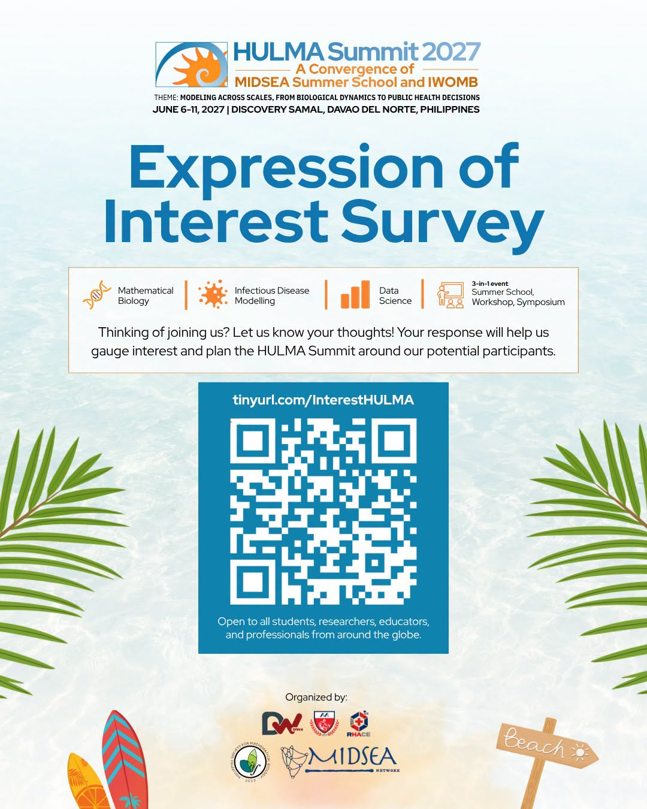

After 3 amazing editions of our beloved **MIDSEA Summer School**, 2027 brings something special: we're joining forces with the **International Workshop on Mathematical Biology (IWOMB)** to bring our two communities together for a special edition → the **2027 HULMA Summit!**

And we're not stopping there. Beyond the packed learning during school/workshop days, we're upgrading our vibrant research poster sessions into a 2-day symposium with abstract submission! Get ready for an exciting week of science, collaboration, and Southeast Asian chaotic fun .

Whether you're a student, researcher, or professional in mathematical biology or data science, filling out our Expression of Interest Survey will help us tailor this premier 3-in-1 event—summer school, workshop, and symposium—around you.   

- 🗓 Date: June 6–11, 2027
- 📍 Venue: Discovery Samal, Davao del Norte, Philippines
- 💡 Theme: Modeling Across Scales, from Biological Dynamics to Public Health Decisions
- 📲 Scan the QR code in the graphic or click the link below to let us know you're interested: [https://tinyurl.com/InterestHULMA](https://tinyurl.com/InterestHULMA)

Check out this teaser of the stunning venue:
[https://lnkd.in/gKBYVVuc](https://lnkd.in/gKBYVVuc)

