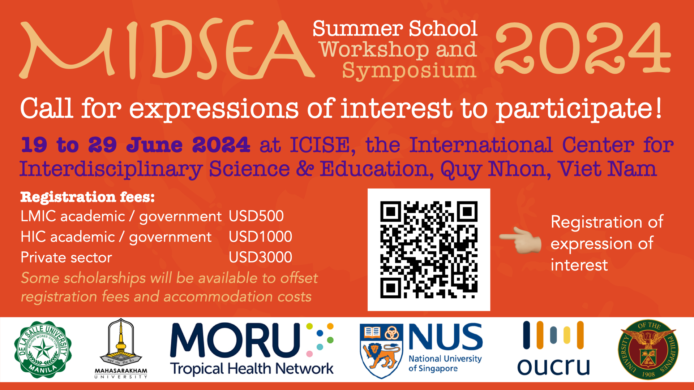

A summer school is currently being planned to take place from 19 to 29 June 2024. This will be held in International Center for Interdisciplinary Science & Education (ICISE), Quy Nhon, Vietnam.
The current registration fees are as shown below. There will be living costs subsidies, flight subsidies and full scholarships provided to selected participants. Please fill in the form below. 

### Registration fees

LMIC Academics / Students / Gov Officials - USD 488 
HIC Academics / Students / Gov Officials - USD 1000 
Private Sector - USD 3000
