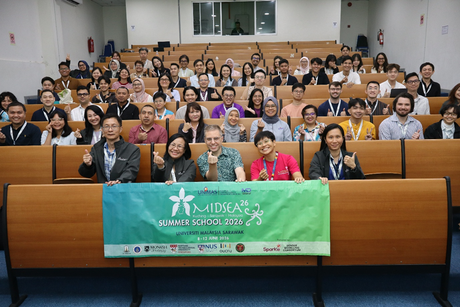

**MIDSEA Summer School 2026 at UNIMAS in Kuching, Malaysia: Strengthened Networks for Shared Knowledge and Future Public Health**

### Building regional public health capacity
Following successful editions in the scenic coastal city of Quy Nhon, Vietnam, in 2024, and in Yogyakarta, Indonesia, home to the world-famous 9th-century UNESCO World Heritage temple complexes of Borobudur and Prambanan in 2025, the third MIDSEA Summer School continued in Sarawak, Malaysia. Held from 8 to 12 June 2026 at Universiti Malaysia Sarawak (UNIMAS) in Kuching, brought together MIDSEAers from local researchers, academics, public health practitioner, and emerging talents from Southeast Asia, India, Korea, Japan, and Australia to exchange knowledge and strengthen collaboration in infectious disease modelling. Set on the rainforest island of Borneo, the world’s third-largest island and a place rich in wildlife and ancient ecologies, the summer school further reinforced MIDSEA’s commitment to regional capacity building, and public health in climate resilience.

### Training in Real-World Public Health Challenges
Hosted by the CSIT faculty at UNIMAS, the MIDSEA Summer School served as a space for technical training, cross-disciplinary research discussions, international networking, and cultural exchange. Created a learning environment where scientific knowledge could connect with regional collaboration and practical public health action.

During the 5 days, MIDSEAers learned from experts from leading regional and international institutions; the National University of Singapore, Mahidol University, Mahasarakham University, Nanyang Technological University, the University of the Philippines Mindanao, the Oxford University Clinical Research Unit, Melbourne University, Monash University, and UNIMAS. Organized in collaboration with the Australian Government’s SPARKLE Programme and the Wellcome-funded Dengue Modelling Consortium, focused on equipping the next generation of infectious disease modelers and public health practitioners with tools to support outbreak preparedness and response.

MIDSEAers joined their preferred four intensive training tracks. Track 1, Modelling 101, introduced early-career and newMIDSEAers to core concepts. Track 2, Simulation, and Track 3, Inference, helped the modelers strengthen their skills and apply more advanced techniques. Track 4, Modelling Heterogeneities, focused on integrating the complexity of infectious disease dynamics into more realistic public health challenges and solutions. Together, these tracks guided MIDSEAers from foundational concepts to advanced disease modelling techniques, epidemiological analysis, programming, simulation, computational methods, and operations research.

### Preparing for Tomorrow’s Challenges
From knowledge to practice, MIDSEAers engaged in real-world public health concerns through intensive regional case studies and practice projects on dengue, rabies, influenza, COVID-19, HIV and RSV. Helping the modeler understand how modelling can support outbreak preparedness and decision-making. The training and workshop brought together parallel learning tracks, specialized plenary workshops, operations research sessions, MIDSEAers’s own research poster presentations, and collaborative group work. Together, these activities helped bridge the gap between infectious disease projections and practical public health decisions, while also showcasing emerging research from MIDSEAers and experts across the region and beyond.

> “…This opportunity was a doorway to a lifetime of “firsts”: my first airplane ride, my first time traveling internationally, and my very first poster presentation. …. Placed in Track 2: Simulations, I realized how vast the ocean of epidemiology truly is, taking a “first swim” in the vast sea of global academia is daunting, but this community made the water feel incredibly welcoming….”
> Jericho Roland Sueno
> MIDSEAer 2026, Ateneo de Manila University, the Philippines

### A Glimpse of Borneo’s Wild Side: A reflection of Climate and Health
After days of intense and deep modelling sessions, workshops, and discussions, MIDSEAers stepped outside the classroom to meet another side of Borneo. A visit to the Semenggoh Wildlife Centre offered a close look at orangutans in their protected habitat and a chance to reflect on how deeply human health is linked with the natural world. MIDSEAers were exposed to a reminder that climate change, shifting environments, wildlife habitats, and infectious disease risks are all part of the same bigger story. The day ended with good food and good conversation, as MIDSEAers continued exchanging ideas and building friendships across the region with delicious local Sarawakian cuisine and dishes.

### Strengthening Capacity, Sustaining Collaboration
With the Philippines set to host the next MIDSEA Summer School in 2027 on its second largest islands with rich and diverse of sanctuaries, cultures and warming people, the network looks ready for even deeper collaboration and a shared commitment to public health security in our ‘middle of the SEA’.

–Vidhyakorn Mahd-Adam

